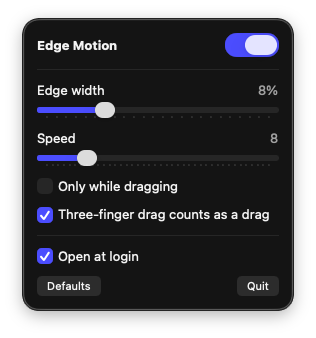

# EdgeMotion

Small app for optimizing touchpad movement on Hackintosh laptop devices.

Windows-style **edge motion** for macOS trackpads: when your finger slides into the edge of the trackpad and stays there, the pointer (or the window you're dragging) keeps moving in that direction. Handy on small trackpads, where you'd otherwise run out of room mid-drag.

Built for a ThinkPad hackintosh (VoodooI2C + VoodooInput), but it works with any trackpad macOS sees as multitouch, including real Mac trackpads.

<p align="center"></p>

## Features

- Menu bar app with a small settings panel
- **Edge width** (2–25 % of the pad) and **speed** sliders, applied live
- Speed ramps up smoothly and grows the deeper your finger sits in the edge
- Works while moving the pointer, click-dragging, and three-finger dragging
- **Only while dragging** mode
- Ignores a thumb resting at the edge, two-finger scrolls and gestures
- Open at login
- Runs in user space: no kext, no reboot, nothing in your EFI

## Install

**Download:** grab `EdgeMotion.zip` from [Releases](../../releases), unzip, and move **Edge Motion** to Applications.

The app isn't notarized, so the first time, right-click it > **Open** (or allow it in System Settings > Privacy & Security). You can also clear the quarantine flag:

```sh
xattr -dr com.apple.quarantine /Applications/EdgeMotion.app
```

**Or build it yourself** (needs Command Line Tools: `xcode-select --install`):

```sh
git clone https://github.com/chxnathanaels/EdgeMotion
cd EdgeMotion
./build.sh --install
```

## First run

1. Allow **Accessibility** when asked (System Settings > Privacy & Security > Accessibility > Edge Motion ON). It's needed to move the pointer.
2. Quit Edge Motion from its menu bar icon and open it again.
3. Turn on **Open at login** in the panel.

After updating or rebuilding, macOS may reset the permission: toggle Edge Motion off and on in the Accessibility list.

## How it works

Edge Motion reads touch frames from Apple's private `MultitouchSupport` framework, tracks the finger that drives the pointer, and when that finger slides into an edge band and stays there, posts mouse-move (or mouse-drag) events through Core Graphics at 100 Hz.

To avoid false triggers it:
- tracks one specific finger by ID,
- ignores fingers that land inside the edge band until they've left it once,
- needs a few stable frames of real outward movement before starting,
- waits ~0.35 s after any multi-finger contact before single-finger edge motion can start,
- drops frames with impossible jumps (finger swaps, sensor glitches).

## Uninstall

Quit it from the menu bar, delete `/Applications/EdgeMotion.app`, and remove it from Accessibility and Login Items.

## Notes

- Uses a private Apple framework, so a future macOS update could break it.
- macOS 13 Ventura or later.

## License

[Apache 2.0](LICENSE)
