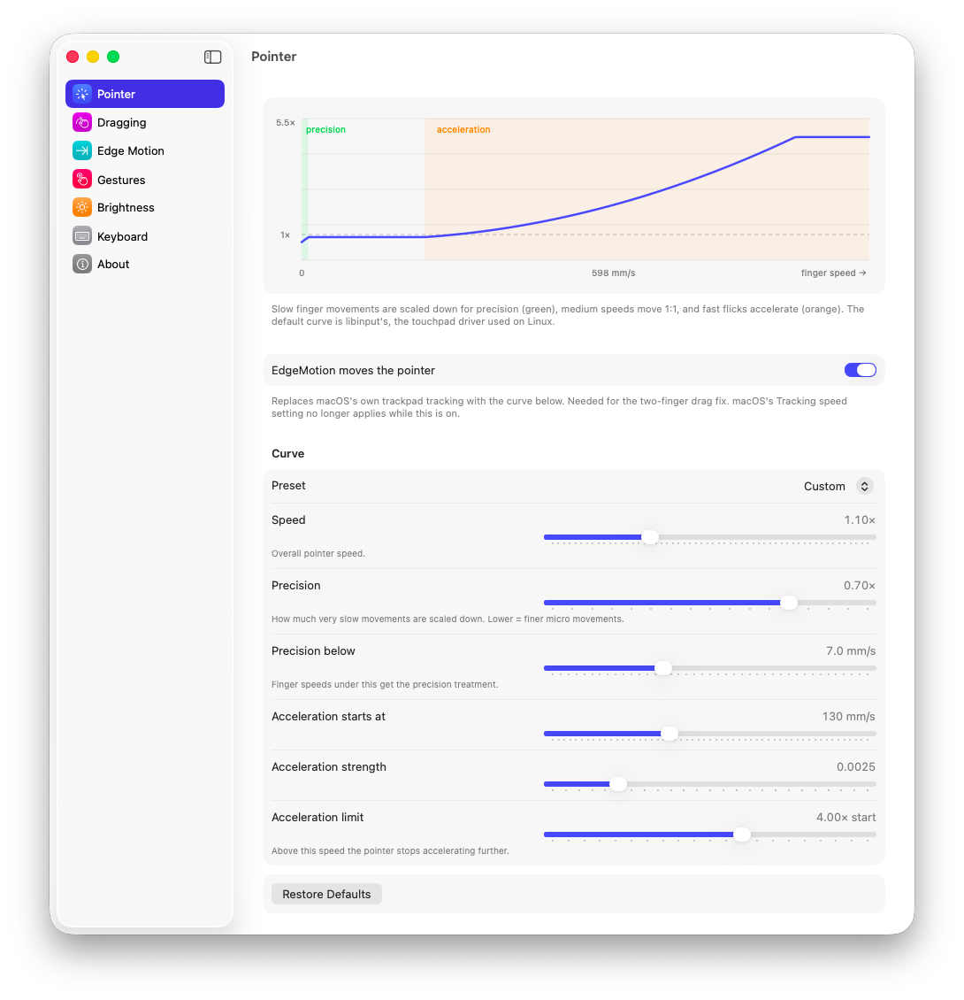
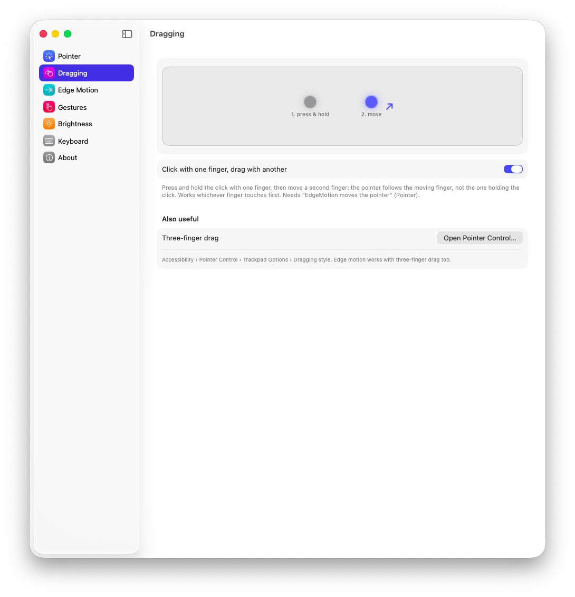
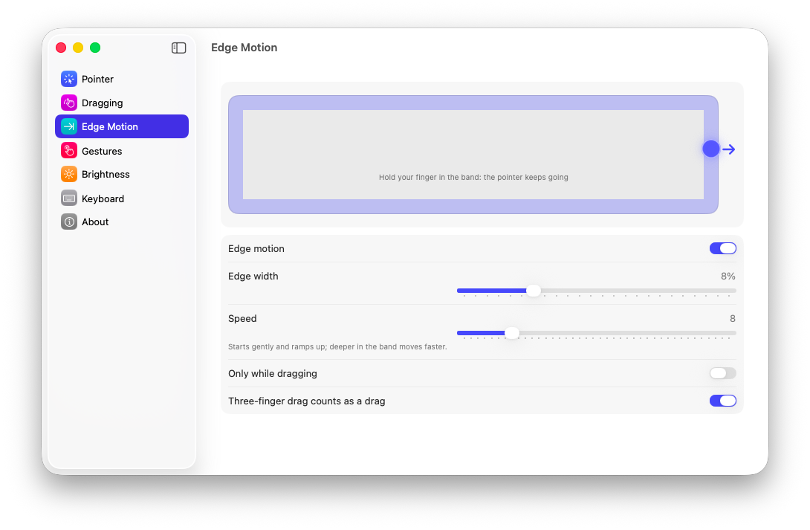
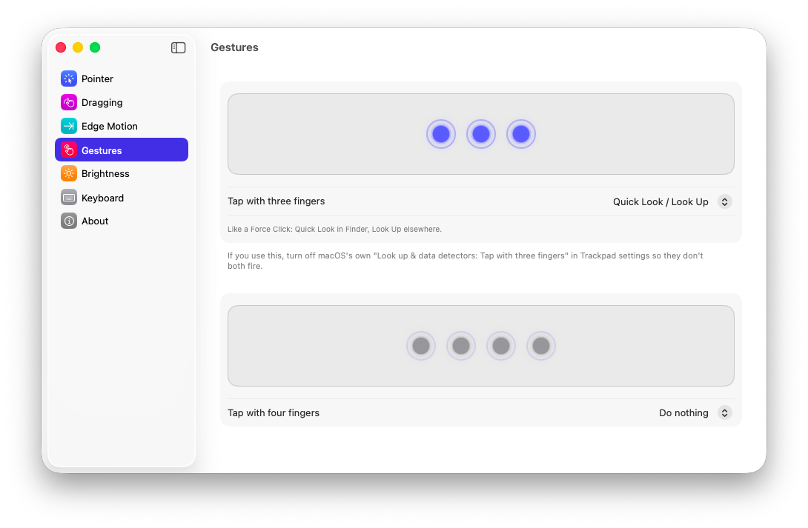
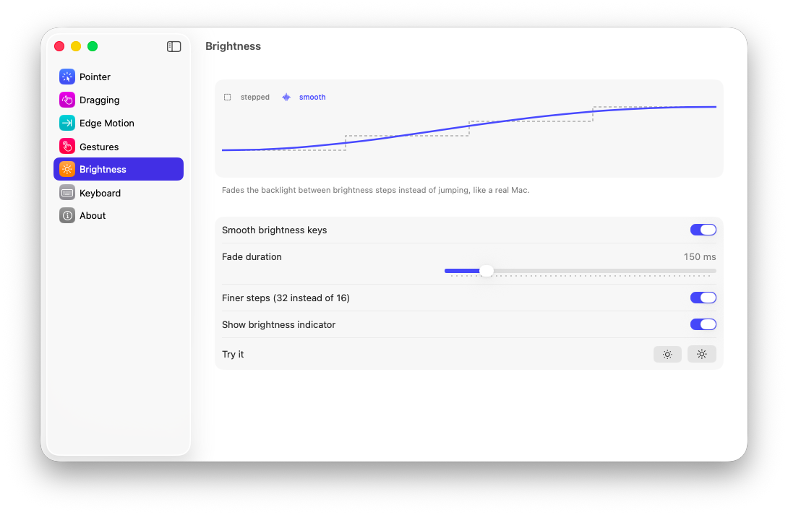
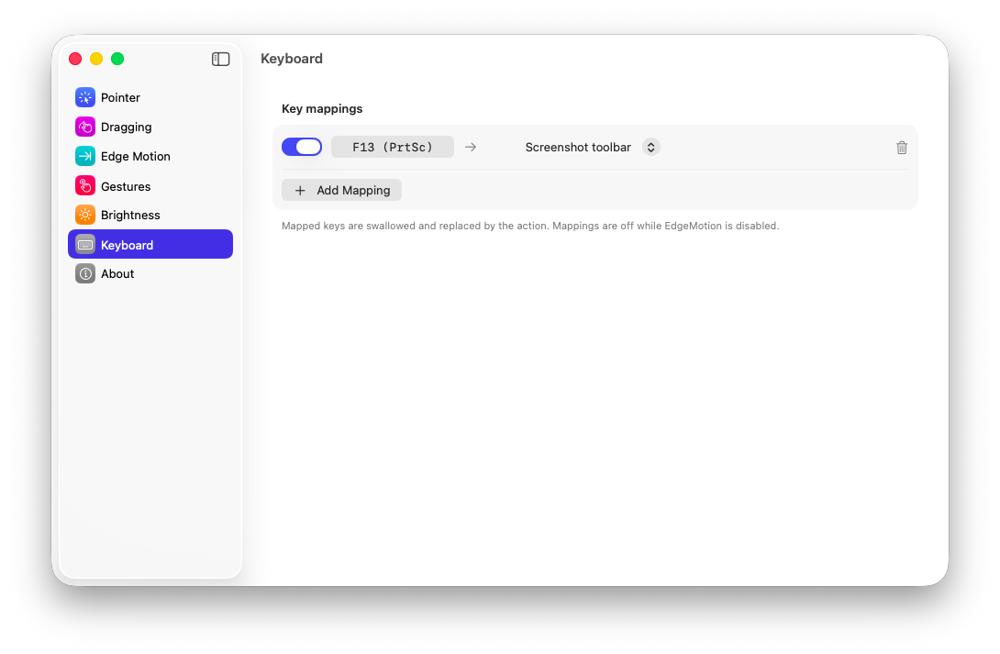

# EdgeMotion

A trackpad companion for macOS hackintosh laptops: better pointer feel, two-finger click-drag, edge motion, tap gestures, smooth brightness and a key mapper, all from a menu bar app.

Built for a ThinkPad T14 hackintosh (VoodooI2C + VoodooInput), but it works with any trackpad macOS sees as multitouch, including real Mac trackpads.

<p align="center"></p>

## Features

### Pointer
EdgeMotion can take over trackpad pointer movement from macOS and apply its own acceleration curve. The default is libinput's touchpad curve, the driver used on Linux: slow movements are scaled down for precise micro adjustments, medium speeds move 1:1, and fast flicks accelerate.

- Presets: Linux (libinput), macOS-like, Linear, or Custom
- Sliders for speed, precision, where acceleration starts, how strong it is and where it stops
- A live graph of the curve, updated as you move the sliders

### Dragging


Press and hold the click with one finger, move a second finger, and the pointer follows the moving finger, not the one holding the click. It works whichever finger touches first, including a thumb pressing the click while your index finger is already moving.

<br clear="right">

### Edge motion


Slide into the edge of the trackpad and hold your finger there: the pointer, or the window you're dragging, keeps moving in that direction, like edge motion on Windows. Handy on small trackpads.

- Adjustable edge width and speed; it starts gently and speeds up
- Works with click-drag and three-finger drag
- Optional "only while dragging"
- Ignores resting thumbs, two-finger scrolls and gestures

<br clear="right">

### Gestures


Three- and four-finger taps, each with its own action:

- Quick Look / Look Up (like Force Click: Quick Look in Finder, Look Up elsewhere)
- Middle click
- Mission Control, App windows, Show Desktop
- Spotlight, screenshot toolbar

<br clear="right">

### Smooth brightness


The brightness keys fade the backlight between steps instead of jumping, like a real Mac.

- Adjustable fade duration
- Optional finer steps (32 instead of 16)
- Small on-screen brightness indicator

<br clear="right">

### Keyboard mapper


Remap any key: press Record, hit the key, pick an action. PrtSc on ThinkPads arrives as F13.

- Screenshot (selection, full screen, toolbar)
- Spotlight, Siri, Mission Control, lock screen
- Open an app, run a Shortcut, type text, or send another key combination

<br clear="right">

### And
- Menu bar panel for quick toggles, plus a full settings window styled like System Settings
- Open at login
- Runs in user space: no kext, no reboot, nothing in your EFI

## Install

**Download:** get `EdgeMotion.zip` from [Releases](../../releases), unzip, and move **EdgeMotion** to Applications.

The app isn't notarized, so the first time, right-click it and choose **Open** (or allow it in System Settings › Privacy & Security). Or clear the quarantine flag:

```sh
xattr -dr com.apple.quarantine /Applications/EdgeMotion.app
```

**Or build it yourself** (needs Command Line Tools: `xcode-select --install`):

```sh
git clone https://github.com/chxnathanaels/EdgeMotion
cd EdgeMotion
./build.sh --install
```

`./build.sh --universal` builds for both Intel and Apple silicon.

## First run

1. Allow **Accessibility** when asked (System Settings › Privacy & Security › Accessibility › EdgeMotion on). It's needed to move the pointer and read keys.
2. Quit EdgeMotion from its menu bar icon and open it again.
3. Open **Settings…** from the menu bar panel and turn on **Open at login** under About.

After updating or rebuilding, macOS may reset the permission: switch EdgeMotion off and on again in the Accessibility list.

If you use the three-finger tap, turn off macOS's own **Look up & data detectors › Tap with three fingers** in Trackpad settings so they don't both fire.

## How it works

EdgeMotion reads touch frames from Apple's private `MultitouchSupport` framework. A small C engine:

- picks the finger that should drive the pointer (the moving one, not the one holding the click),
- applies the acceleration curve and posts the pointer movement,
- adds edge motion while a finger rests in the edge band,
- detects quick multi-finger taps.

A system event tap hides macOS's own trackpad pointer motion while EdgeMotion is driving, handles the brightness keys and applies key mappings. Brightness uses the system's display brightness API, with an animated fade between steps.

The acceleration curve follows libinput's touchpad profile: a precision zone that scales slow movement down (to 30 % by default), a 1:1 plateau, then a curve that accelerates up to four times the threshold speed.

If the pointer ever feels wrong, turn off **EdgeMotion moves the pointer** in the menu bar panel. macOS takes over again instantly.

## Uninstall

Quit EdgeMotion from the menu bar, delete `/Applications/EdgeMotion.app`, and remove it from Accessibility and Login Items.

## Notes

- macOS 13 Ventura or later. Developed and tested on macOS Tahoe 26.7.1 (ThinkPad T14 Gen 4 hackintosh).
- Uses private Apple frameworks (MultitouchSupport, DisplayServices), so a future macOS update could break parts of it.
- While EdgeMotion moves the pointer, macOS's Tracking speed setting doesn't apply; use EdgeMotion's Speed slider instead.

## Credits

- Acceleration curve adapted from [libinput](https://gitlab.freedesktop.org/libinput/libinput) (MIT).
- Touch reading via Apple's private MultitouchSupport framework, as used by many open-source trackpad tools.

## License

[Apache 2.0](LICENSE)
